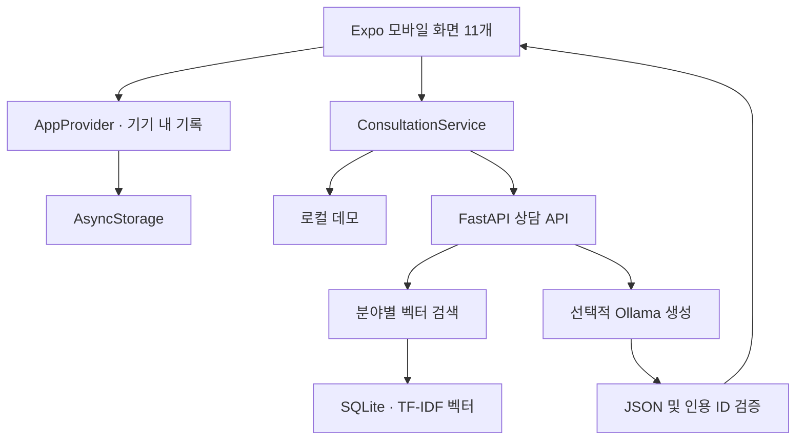
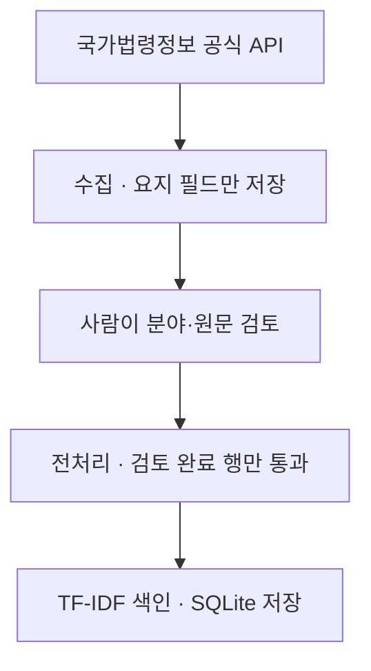

# 구조 및 데이터 흐름

## 역할 분리

- `app/src/app`: 라우트 및 탭·스택 레이아웃.
- `app/src/screens`: 각 기능 화면. 실제 UI 구현은 여기서 수정합니다.
- `app/src/components/ui.tsx`: 공통 입력창·버튼·카드·색상.
- `app/src/domain/model.ts`: 타입, 입력 검증, 사건 저장 규칙.
- `app/src/state/AppProvider.tsx`: 초기 읽기, 순서대로 기기 저장, 오류 재시도.
- `app/src/services/consultation.ts`: 데모/HTTP 구현 전환, 응답·출처 검증.
- `server/app/models.py`: 요청/응답 스키마와 입력 제한.
- `server/app/vector_store.py`: 벡터 저장/검색.
- `server/app/main.py`: 상담 API, 검색·생성 연결.
- `data/scripts`: 수집·정제·색인 구축을 분리한 명령행 도구.

## 제약과 확장 지점

현재 서버는 개발용 상담 API이며 사용자 인증·사건 저장 서버를 갖추지 않았습니다. 정식 배포 전에는 계정 인증, 본인 사건 접근제어, 전송 및 저장 보호, 요청 제한, 데이터 삭제 정책을 구현해야 합니다.

기본 벡터는 문자 기반 TF-IDF로서 의미 검색 모델이 아닙니다. 규모가 커지면 벡터 저장소 인터페이스를 분리하고 한국어 임베딩·전용 벡터DB를 선택하여 검색 품질을 평가해야 합니다. 분야 필터와 원문 메타데이터는 유지합니다.

공식 API 인증값은 `server/.env`에만 둡니다. 앱에 포함되는 `EXPO_PUBLIC_*`에는 비밀값을 넣지 않습니다.
