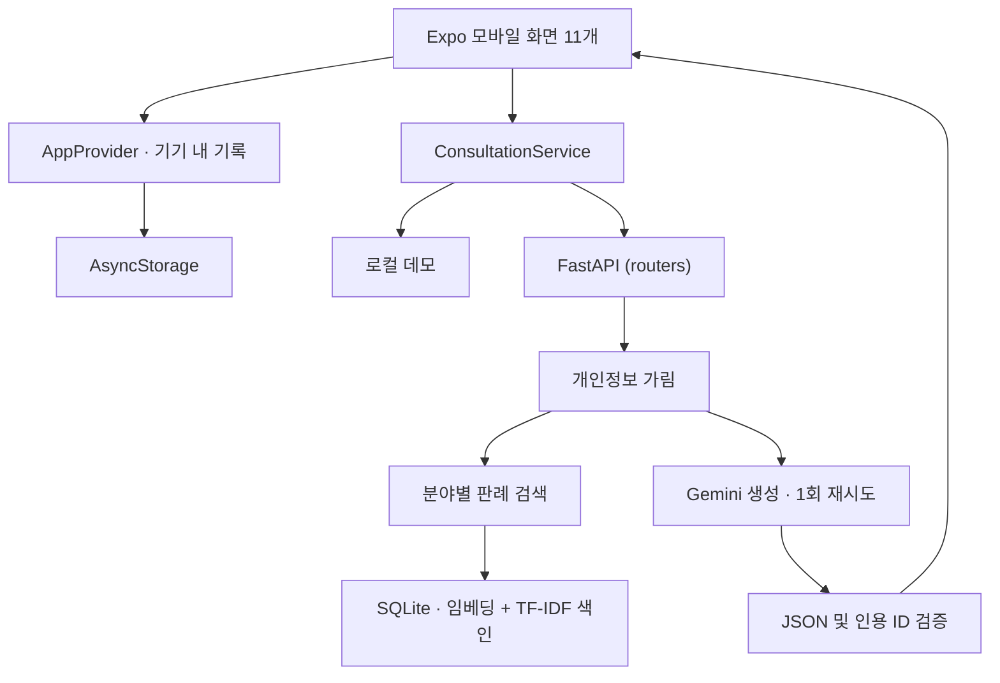
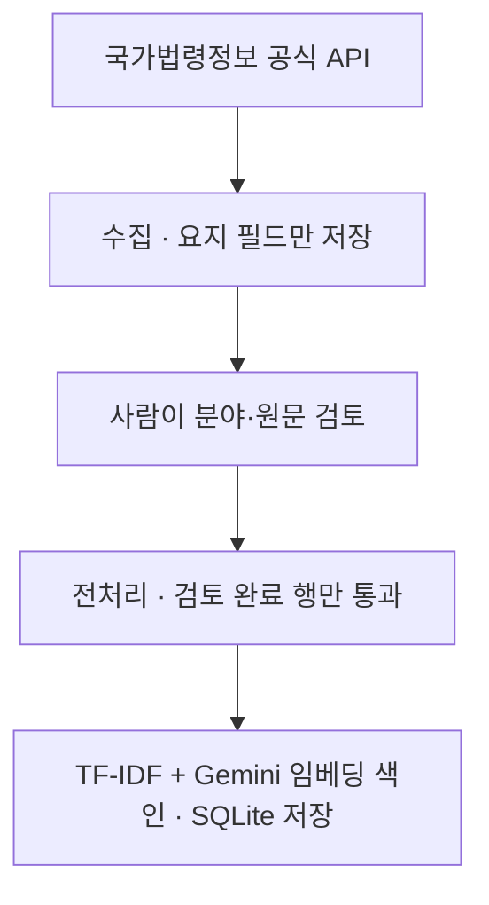

# 구조 및 데이터 흐름

## 역할 분리

- `app/src/app`: 라우트 및 탭·스택 레이아웃.
- `app/src/screens`: 각 기능 화면. 실제 UI 구현은 여기서 수정합니다.
- `app/src/components/ui.tsx`: 공통 입력창·버튼·카드·색상.
- `app/src/domain/model.ts`: 타입, 입력 검증, 사건 저장 규칙.
- `app/src/state/AppProvider.tsx`: 초기 읽기, 순서대로 기기 저장, 오류 재시도.
- `app/src/services/consultation.ts`: 데모/HTTP 구현 전환, 응답·출처 검증.
- `server/app/routers`: 요청 처리부(API 경로, 입력 검증, 인증 확인).
- `server/app/services`: 검색·생성부(상담 흐름, 판례 검색, Gemini 연계, 개인정보 가림).
- `server/app/repositories`: 저장소 인터페이스와 SQLite 구현(판례 색인).
- `data/scripts`: 수집·정제·색인 구축을 분리한 명령행 도구.

서버 파일별 설명은 `server/README.md`를 참고하세요.

## 제약과 확장 지점

상담 기록과 사건은 기기에만 저장하므로 서버에는 판례 색인만 있습니다. 회원·인증은 계정 흐름 담당이 추가합니다. 사건을 서버에 저장하게 되면 `CaseRepository` 인터페이스와 구현, 소유권 확인을 추가합니다.

서비스 코드는 저장소 인터페이스에만 의존합니다. 서버를 여러 대로 늘리거나 배포 환경이 DB 파일을 보존하지 못하면 `USER_DB_URL`과 새 저장소 구현으로 외부 DB로 옮깁니다. 요청 제한(rate limit)은 아직 없습니다.

공식 API 인증값과 Gemini API 키는 `server/.env`에만 둡니다. 앱에 포함되는 `EXPO_PUBLIC_*`에는 비밀값을 넣지 않습니다.
